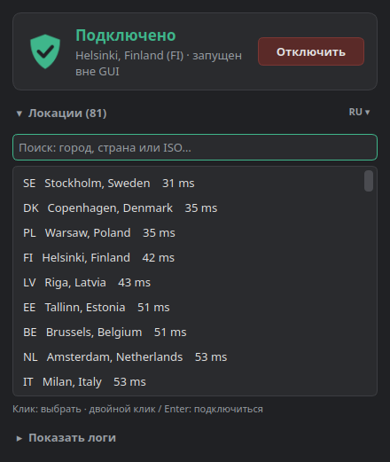

# AdGuard VPN Tray

[Русский](README.md) · **English**

An **unofficial** system tray client for [AdGuard VPN CLI](https://github.com/AdguardTeam/AdGuardVPNCLI) on Linux.
A single binary with a dark theme, built on top of the stock `adguardvpn-cli` utility.

<p align="center"></p>

> The UI is currently in Russian only. The screenshot reads: *Connected · Disconnect · Locations · Search: city, country or ISO… · Show logs*.

## Features

- Tray icon shows the status: 🟢 connected · 🟡 connecting · ⚪ disconnected · 🔴 login required.
- Connect / Disconnect button for the last selected location, in the window and in the tray menu.
- Location list with ping and search by city, country or ISO code (double-click or Enter to connect).
- "Show logs": live output of `adguardvpn-cli connect`, just like in a terminal.
- Detects a connection started from a terminal and can disconnect it.
- Account login via the browser (`adguardvpn-cli login`).
- Closing the window hides the app to the tray. To quit, right-click the icon → Quit.
- Single instance: launching it again brings up the existing window.

## Requirements

| What | Why |
|---|---|
| Linux x86_64, glibc ≥ 2.28 (Ubuntu 22.04+, Debian 12+, Fedora 38+…) | Tested on Xubuntu 26.04 |
| A panel with a system tray | XFCE, KDE, Cinnamon and MATE work out of the box. GNOME needs the *AppIndicator* extension. |
| [`adguardvpn-cli`](https://github.com/AdguardTeam/AdGuardVPNCLI) in `PATH` | The VPN connection itself (not bundled) |
| `libxcb-cursor0` | Required by Qt 6 on X11: `sudo apt install libxcb-cursor0` |
| [`uv`](https://docs.astral.sh/uv/) | Only for building from source |

## Installation

### From a release

Install the latest version with one command:

```bash
mkdir -p ~/.local/bin
curl -fsSL https://github.com/nallan-dev/adguard-tray/releases/latest/download/adguard-tray-linux-x86_64.tar.gz \
  | tar -xz --wildcards --strip-components=1 -C ~/.local/bin 'adguard-tray-*/adguard-tray'
adguard-tray            # or: adguard-tray --hidden (start minimized to tray)
```

Or download the archive manually from [Releases](https://github.com/nallan-dev/adguard-tray/releases). The checksum is in the `.sha256` file.

### From source

```bash
git clone https://github.com/nallan-dev/adguard-tray.git && cd adguard-tray
make doctor                      # check dependencies
make build install autostart     # build, install, enable autostart
```

Run `make` with no arguments to list all targets:

| Target | Description |
|---|---|
| `help` | Show help |
| `doctor` | Check that everything required is installed |
| `deps` | Install dependencies into `.venv` (`uv sync`) |
| `run` | Run from source |
| `test` | Run tests |
| `build` | Build a single binary `dist/adguard-tray` |
| `install` | Install to `~/.local/bin` and add an app menu entry |
| `autostart` | Start on login (minimized to tray) |
| `no-autostart` | Disable autostart |
| `uninstall` | Remove the binary and menu entry (config is kept) |
| `dist` | Build a release archive |
| `release` | Tag `v<version>` and trigger a GitHub release build |
| `clean` | Remove build artifacts |

## Root privileges

In TUN mode `adguardvpn-cli connect` needs root. A GUI cannot type a password into a terminal, so there are two options.

**1. No setup.** The app asks for your password through the system `pkexec` (polkit) dialog on every connect and disconnect.

**2. Passwordless.** Add a sudo rule with `sudo visudo -f /etc/sudoers.d/adguard-tray`:

```sudoers
youruser ALL=(root) NOPASSWD:SETENV: /usr/local/bin/adguardvpn-cli, /usr/bin/kill
```

Use your own username and the path from `command -v adguardvpn-cli`. `SETENV` lets the CLI keep your `HOME` (`~/.local/share/adguardvpn-cli`), as it does when you run it yourself.
The app detects that passwordless sudo is available and uses it.

> ⚠️ This trades security for convenience: `NOPASSWD` on `kill` lets your user terminate any root process without a password. That is usually fine on a personal desktop. If it is not fine for you, stay with option 1.

## How it works

The app knows nothing about the AdGuard protocol. It just calls `adguardvpn-cli`:

| Action | Command |
|---|---|
| Connect | `sudo -n HOME=$HOME adguardvpn-cli connect --no-fork -y -l <city>` (output goes to the log panel) |
| Disconnect | `sudo -n kill -INT <pid>`, the same as Ctrl+C in a terminal |
| Status | look for an `adguardvpn-cli connect` process in `/proc`, plus a `tun*` interface |
| Locations | `adguardvpn-cli list-locations` |
| Login | `adguardvpn-cli login` (the link opens in the browser) |

Why not `status` and `disconnect`? In `--no-fork` mode the CLI writes no pid file, so `status` always reports "disconnected" and `disconnect` fails with "Process is not running". The app calls `status` every 30 seconds only to check whether you are logged in.

Files:

- `~/.config/adguard-tray/config.json`: last location, whether logs are shown.
- `~/.local/bin/adguard-tray`: the binary.
- `~/.local/share/applications/adguard-tray.desktop`: menu entry.
- `~/.config/autostart/adguard-tray.desktop`: autostart.

## Limitations

- If the VPN was started from a terminal, its logs are visible only in that terminal. The GUI shows its status and can disconnect it.
- The connection is detected by a network interface named `tun*`.
- The UI is in Russian only.
- Tested with `adguardvpn-cli` v1.8. If the CLI output format changes, the parsers in `adguard_tray/cli.py` may need an update.

## Development

```bash
make run     # run from source
make test    # pytest
```

Layout:

```
adguard_tray/
  cli.py         # CLI calls, output parsing, process detection
  controller.py  # async logic (QProcess, timers, signals)
  window.py      # main window
  main.py        # tray, menu, single instance
  theme.py       # dark theme and icon (drawn in code)
  config.py      # ~/.config/adguard-tray/config.json
```

Stack: Python 3.11+, PySide6 (Qt 6), PyInstaller for the binary.

### Releasing

1. Bump `version` in `pyproject.toml` and commit.
2. Run `make release`: it creates the `v<version>` tag and pushes it.
3. GitHub Actions ([`release.yml`](.github/workflows/release.yml)) runs the tests, builds the binary on Ubuntu 22.04 and publishes a release with the archive and `.sha256`.

For a test build without a release, run it manually: Actions → Release → *Run workflow*. The binary is uploaded as a workflow artifact.

## License and legal

- The code is licensed under [MIT](LICENSE).
- This project is **not affiliated with or endorsed by AdGuard**. "AdGuard" is a trademark of AdGuard Software Ltd. The name is used only to describe compatibility.
- `adguardvpn-cli` is not included or redistributed. Install it separately; it is covered by the [AdGuard license](https://adguard-vpn.com/eula.html).
- The binary bundles Qt / PySide6 under LGPLv3 and other components. See [THIRD_PARTY.md](THIRD_PARTY.md).
