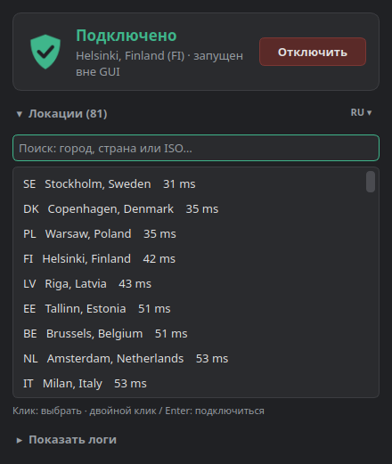

# AdGuard VPN Tray

**Русский** · [English](README.en.md)

**Неофициальный** трей-клиент для [AdGuard VPN CLI](https://github.com/AdguardTeam/AdGuardVPNCLI) на Linux.
Один бинарник, тёмная тема, работает поверх штатной утилиты `adguardvpn-cli`.

<p align="center"></p>

## Возможности

- Иконка в трее со статусом: 🟢 подключено · 🟡 подключение · ⚪ отключено · 🔴 нужен вход.
- Кнопка «Подключить / Отключить» для последней выбранной локации, в окне и в меню трея.
- Список локаций с пингом и поиском по городу, стране или ISO-коду (двойной клик или Enter, чтобы подключиться).
- «Показать логи»: живой вывод `adguardvpn-cli connect`, как в консоли.
- Видит подключение, запущенное из терминала, и умеет его отключить.
- Вход в аккаунт через браузер (`adguardvpn-cli login`).
- Закрытие окна сворачивает приложение в трей, выход через ПКМ по иконке → «Выход».
- Повторный запуск не плодит копии, а показывает уже открытое окно.

## Требования

| Что | Зачем |
|---|---|
| Linux x86_64, glibc ≥ 2.28 (Ubuntu 22.04+, Debian 12+, Fedora 38+…) | Проверено на Xubuntu 26.04 |
| Панель с системным треем | XFCE, KDE, Cinnamon, MATE работают сразу. В GNOME нужно расширение *AppIndicator*. |
| [`adguardvpn-cli`](https://github.com/AdguardTeam/AdGuardVPNCLI) в `PATH` | Само VPN-подключение (в комплект не входит) |
| `libxcb-cursor0` | Нужна Qt 6 под X11: `sudo apt install libxcb-cursor0` |
| [`uv`](https://docs.astral.sh/uv/) | Только для сборки из исходников |

## Установка

### Из готового релиза

Последняя версия одной командой:

```bash
mkdir -p ~/.local/bin
curl -fsSL https://github.com/nallan-dev/adguard-tray/releases/latest/download/adguard-tray-linux-x86_64.tar.gz \
  | tar -xz --wildcards --strip-components=1 -C ~/.local/bin 'adguard-tray-*/adguard-tray'
adguard-tray            # или: adguard-tray --hidden (сразу в трей)
```

Или скачайте архив вручную со страницы [Releases](https://github.com/nallan-dev/adguard-tray/releases) (контрольная сумма лежит в `.sha256`).

### Из исходников

```bash
git clone https://github.com/nallan-dev/adguard-tray.git && cd adguard-tray
make doctor                      # проверить зависимости
make build install autostart     # собрать, поставить, включить автозапуск
```

`make` без аргументов покажет все цели:

```
Общее
  help           Показать эту справку
  doctor         Проверить, что всё нужное установлено
Разработка
  deps           Установить зависимости в .venv (uv sync)
  run            Запустить из исходников
  test           Прогнать тесты
Сборка и установка
  build          Собрать один бинарник dist/adguard-tray
  install        Установить в ~/.local/bin и добавить в меню приложений
  autostart      Включить автозапуск при входе (сразу в трей)
  no-autostart   Выключить автозапуск
  uninstall      Удалить бинарник и пункт меню (конфиг остаётся)
  dist           Собрать архив для GitHub Releases
  release        Поставить тег v<версия> и запустить сборку релиза на GitHub
  clean          Удалить артефакты сборки
```

## Права root

В режиме TUN `adguardvpn-cli connect` требует root. Окно GUI не может ввести пароль в терминал, поэтому есть два варианта.

**1. Без настройки.** Приложение запросит пароль через системное окно `pkexec` (polkit) при каждом подключении и отключении.

**2. Без пароля.** Добавьте правило sudo (через `sudo visudo -f /etc/sudoers.d/adguard-tray`):

```sudoers
youruser ALL=(root) NOPASSWD:SETENV: /usr/local/bin/adguardvpn-cli, /usr/bin/kill
```

Подставьте свой логин и путь из `command -v adguardvpn-cli`. `SETENV` нужен, чтобы CLI работал с вашим `HOME` (`~/.local/share/adguardvpn-cli`), как при обычном запуске.
Приложение само определяет, что sudo без пароля доступен, и пользуется им.

> ⚠️ Это компромисс удобства и безопасности: `NOPASSWD` на `kill` позволяет вашему пользователю без пароля завершить любой процесс от root. Для личного десктопа это обычно приемлемо. Если нет, оставайтесь на варианте 1.

## Как это устроено

Приложение ничего не знает о протоколе AdGuard. Оно просто вызывает `adguardvpn-cli`:

| Действие | Команда |
|---|---|
| Подключение | `sudo -n HOME=$HOME adguardvpn-cli connect --no-fork -y -l <город>` (вывод идёт в панель логов) |
| Отключение | `sudo -n kill -INT <pid>`, то же, что Ctrl+C в консоли |
| Статус | поиск процесса `adguardvpn-cli connect` в `/proc` + наличие интерфейса `tun*` |
| Локации | `adguardvpn-cli list-locations` |
| Вход | `adguardvpn-cli login` (ссылка открывается в браузере) |

Почему не `status` и `disconnect`: в режиме `--no-fork` CLI не пишет pid-файл, поэтому `status` всегда отвечает «disconnected», а `disconnect` отвечает «Process is not running». `status` вызывается раз в 30 с только для проверки входа в аккаунт.

Файлы:

- `~/.config/adguard-tray/config.json`: последняя локация, показывать ли логи.
- `~/.local/bin/adguard-tray`: бинарник.
- `~/.local/share/applications/adguard-tray.desktop`: пункт меню.
- `~/.config/autostart/adguard-tray.desktop`: автозапуск.

## Ограничения

- Если VPN запущен из терминала, его логи видны только в том терминале. GUI показывает статус и умеет его отключить.
- Подключение определяется по интерфейсу с именем `tun*`.
- Интерфейс только на русском.
- Проверено с `adguardvpn-cli` v1.8. Если формат вывода CLI изменится, может понадобиться поправить парсеры в `adguard_tray/cli.py`.

## Разработка

```bash
make run     # запуск из исходников
make test    # pytest
```

Структура:

```
adguard_tray/
  cli.py         # вызовы CLI, парсинг вывода, поиск процесса
  controller.py  # асинхронная логика (QProcess, таймеры, сигналы)
  window.py      # главное окно
  main.py        # трей, меню, single-instance
  theme.py       # тёмная тема и иконка (рисуется кодом)
  config.py      # ~/.config/adguard-tray/config.json
```

Стек: Python 3.11+, PySide6 (Qt 6), PyInstaller для бинарника.

### Выпуск версии

1. Поднимите `version` в `pyproject.toml` и закоммитьте.
2. `make release`: ставит тег `v<версия>` и пушит его.
3. GitHub Actions ([`release.yml`](.github/workflows/release.yml)) прогоняет тесты, собирает бинарник на Ubuntu 22.04 и публикует релиз с архивом и `.sha256`.

Пробную сборку без релиза можно запустить вручную: Actions → Release → *Run workflow*. Бинарник будет в артефактах.

## Лицензия и правовое

- Код распространяется под лицензией [MIT](LICENSE).
- Проект **не связан с AdGuard** и не одобрен ею. «AdGuard» является товарным знаком AdGuard Software Ltd. Название используется только для описания совместимости.
- `adguardvpn-cli` в проект не входит и не распространяется вместе с ним. Его нужно установить отдельно, на него действует [лицензия AdGuard](https://adguard-vpn.com/eula.html).
- Бинарник включает Qt / PySide6 под LGPLv3 и другие компоненты, подробнее в [THIRD_PARTY.md](THIRD_PARTY.md).
